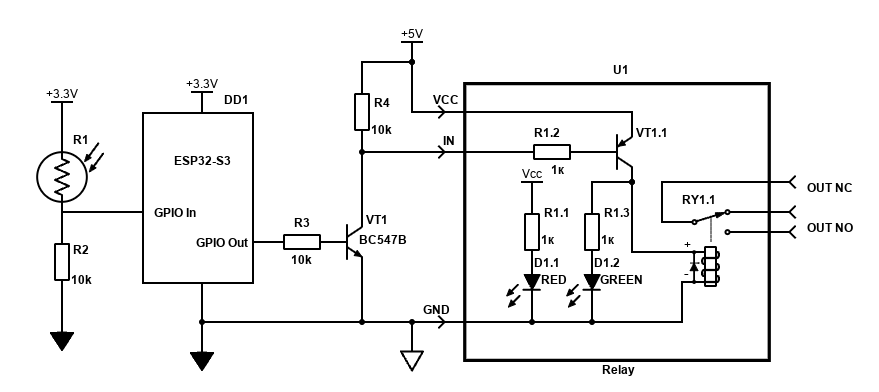

All homeworks are going to be included in single repo.  
In order to switch between different programs select proper env (mentioned in each program `env` section) and *Upload* it to board.

---

# Homework 1 (Module 1.3):
Створити програму для ESP32, яка керує двома світлодіодами (червоний і синій) та імітує роботу поліцейської мигалки.

## Program 1:
**Task:**  
- Використати два GPIO-виводи ESP32.  
- Під’єднати червоний та синій світлодіоди через резистори.  
- Реалізувати послідовність миготіння, у якій червоний і синій LED блимають по черзі.  
- Програма має працювати циклічно.  

**Scheme:**  

    ESP32-S3 DevKit  
    ┌─────────────┐  
    │             │  
    │      GPIO 1 ├──────[ Resistor 220 Ohm ]──────(A) LED_RED (C)──────┐  
    │             │                                                     │  
    │      GPIO 2 ├──────[ Resistor 220 Ohm ]──────(A) LED_BLUE (C)─────┤  
    │             │                                                     │  
    │        GND  ├─────────────────────────────────────────────────────┘  
    │             │  
    └─────────────┘  

  * LED: (A) = Anode (long lead, `+`), (C) = Cathode (short lead, `-`)  

**Notes**  
Simple single loop for both LEDs blinking.  

**env:**  
`env:hw1_program1`  


## Program 2:
**Task:**  
- ускладнити патерн миготіння  

**Scheme:**  

    ESP32-S3 DevKit  
    ┌─────────────┐  
    │             │  
    │      GPIO 1 ├──────[ Resistor 220 Ohm ]──────(A) LED_RED (C)──────┐  
    │             │                                                     │  
    │      GPIO 2 ├──────[ Resistor 220 Ohm ]──────(A) LED_BLUE (C)─────┤  
    │             │                                                     │  
    │        GND  ├─────────────────────────────────────────────────────┘  
    │             │  
    └─────────────┘  

  * LED: (A) = Anode (long lead, `+`), (C) = Cathode (short lead, `-`)  

**Notes**  
Async tasks for independent LEDs control.  

**env:**  
`env:hw1_program2`  


## Program 3:
**Task:**  
- додати третій світлодіод  

**Scheme:**  

    ESP32-S3 DevKit  
    ┌─────────────┐  
    │             │  
    │      GPIO 4 ├──────[ Resistor 220 Ohm ]──────(A) LED_RED (C)──────┐  
    │             │                                                     │  
    │      GPIO 5 ├──────[ Resistor 220 Ohm ]──────(A) LED_BLUE (C)─────┤  
    │             │                                                     │  
    │      GPIO 6 ├──────[ Resistor 220 Ohm ]──────(A) LED_GREEN (C)────┤  
    │             │                                                     │  
    │        GND  ├─────────────────────────────────────────────────────┘  
    │             │  
    └─────────────┘  

  * LED: (A) = Anode (long lead, `+`), (C) = Cathode (short lead, `-`)  

**Notes**  
Simple loop but with LL approach.  

**env:**  
`env:hw1_program3`  


## Program 4:
**Task:**  
- змінювати швидкість миготіння  

**Scheme:**  

    ESP32-S3 DevKit  
    ┌─────────────┐  
    │             │  
    │      GPIO 4 ├──────[ Resistor 220 Ohm ]──────(A) LED_RED (C)──────┐  
    │             │                                                     │  
    │        GND  ├─────────────────────────────────────────────────────┘  
    │             │  
    └─────────────┘  

  * LED: (A) = Anode (long lead, `+`), (C) = Cathode (short lead, `-`)  

**Notes**  
Simple loop but using registers and interruptions.  

**env:**  
`env:hw1_program4`  


## Program 5:
**Task:**  
- зменшити кількість задіяних пінів: змусити обидва світлодіоди блимати по черзі за допомогою лише одного GPIO-виводу.  

**Scheme:**  

    ESP32-S3 DevKit  
    ┌─────────────┐  
    │             │  
    │        3V3  ├──────[ Resistor 220 Ohm ]──────(A) LED_RED (C)──────┐  
    │             │                                                     │
    │      GPIO 4 ├─────────────────────────────────────────────────────┤  
    │             │                                                     │  
    │        GND  ├──────[ Resistor 220 Ohm ]──────(C) LED_BLUE (A)─────┘  
    │             │  
    └─────────────┘  

  * LED: (A) = Anode (long lead, `+`), (C) = Cathode (short lead, `-`)  

**Notes**  
Simple loop. Which LED On is controlled by current direction (level on GPIO).  

**env:**  
`env:hw1_program5`  

---

# Homework 2 (Module 1.4):
**Мета роботи:** Навчитися конфігурувати цифрові виводи мікроконтролера в режими входу та виходу, освоїти роботу з вбудованою підтяжкою (INPUT_PULLUP).

**Task:**  
1. Апаратні вимоги (Схемотехніка):
Світлодіоди: Під’єднати два світлодіоди до будь-яких вільних цифрових пінів плати ESP32-S3 (наприклад, GPIO 15 та 16) обов'язково через обмежувальні резистори номіналом 220 Ом.
Зовнішня кнопка: Під’єднати тактову кнопку до одного з вільних GPIO (наприклад, GPIO 21).
Вбудована кнопка: Як другу кнопку використати розпаяну на платі кнопку BOOT (GPIO 0). Додаткового монтажу для неї не потрібно.
2. Опис режимів роботи
Програма повинна циклічно виконувати один із двох режимів, перемикання між якими фіксується в пам'яті (стан за замовчуванням при старті - Режим №1):
Режим №1 (Швидкий / Синхронний): активується натисканням зовнішньої кнопки.
Візуальний ефект: Обидва світлодіоди працюють синхронно - одночасно вмикаються і одночасно вимикаються з короткою затримкою delay(200).
Режим №2 (Повільний / По черзі):  активується натисканням вбудованої кнопки BOOT (GPIO 0).
Візуальний ефект: Світлодіоди миготять по черзі (ефект залізничного переїзду) - коли перший горить, другий згашений, і навпаки, з довгою затримкою delay(1000).
3. Програмні вимоги (Алгоритм)
Ініціалізація пінів:
Налаштувати піни світлодіодів як OUTPUT.
Налаштувати зовнішню кнопку в режим INPUT_PULLUP.
Налаштувати кнопку BOOT у режим INPUT (вона вже має апаратну зовнішню pull-up підтяжку на платі).
Фіксація стану: Після одноразового натискання кнопки вибраний темп і тип миготіння мають зберігатися, поки не буде натиснуто іншу кнопку.

**Scheme:**  

    ESP32-S3 DevKit  
    ┌─────────────┐  
    │ ┌┬┐ *       │  
    │ ─/─  GPIO 0 │  
    │             │  
    │      GPIO 4 ├──────[ Resistor 220 Ohm ]──────(A) LED_RED (C)──────┐  
    │             │                                                     │  
    │      GPIO 5 ├──────[ Resistor 220 Ohm ]──────(A) LED_BLUE (C)─────┤  
    │             │      ┌┬┐                                            │  
    │      GPIO 6 ├───────/─────────────────────────────────────────────┤  
    │             │                                                     │  
    │        GND  ├─────────────────────────────────────────────────────┘  
    │             │  
    └─────────────┘  

  * LED: (A) = Anode (long lead, `+`), (C) = Cathode (short lead, `-`)  
  * built-in 'BOOT' push-button (interconnected with GPIO 0)

**env:**  
`env:hw2_program1`  

---

# Homework 3 (Module 1.5):
**Мета роботи:** Виміряти брязкіт контактів кнопки, порівняти «реальну» кількість імпульсів (з логічного аналізатора) з тим, що вловлює мікроконтролер через апаратні переривання.

**Task:**  
- Кнопка (pull-up):  Підключається на макетній платі до піна GPIO 16 мікроконтролера ESP32S3.  
- Логічний аналізатор:  Канал 1 аналізатора підключити безпосередньо до піна GPIO 16, куди під'єднано кнопку.  
- Написати простий код на мікроконтролері, який рахує імпульси (зміни стану).  
- Натиснути кнопку 10 разів із різною швидкістю й силою.
- Логічним аналізатором записати форму сигналу кожного натискання.
- Для кожного натискання визначити:
  - скільки імпульсів брязкоту виникло насправді
  - тривалість брязкоту (у мілісекундах)
- Порівняти:
  - кількість імпульсів, які бачить логічний аналізатор
  - кількість імпульсів, які зареєстрував мікроконтролер
- Питання для аналізу
  1. Чи співпадає кількість імпульсів на графіку логічного аналізатора та в лічильнику мікроконтролера?
  2. У яких випадках мікроконтролер «пропускає» частину брязкоту (якщо таке трапляється), а коли навпаки — «перераховує зайве»?
  3. Яка середня тривалість брязкоту для вашої кнопки?
  4. Який мінімальний debounce (затримка / логіка фільтрації) був би достатній?

**Scheme:**  

    ESP32-S3 DevKit                      Logic Analyzer  
    ┌─────────────┐                      ┌─────────────┐  
    │             │                      │             │  
    │     GPIO 16 ├──────────┬───────────┤ CH1         │  
    │             │          │           │             │  
    │             │          / *         │             │  
    │             │          │           │             │  
    │        GND  ├──────────┴───────────┤ GND         │  
    │             │                      │             │  
    └─────────────┘                      └─────────────┘  

  * external push-button  

**env:**  
`env:hw3_program1`  

**Conclusions:**  
1. Не співпадає;  
2. Контролер переважно (у всіх випадках крім одного) нараховує більше спрацювань;  
3. 660 мкС (1.22 мС, 1.79 мС, 0.7 мС, 7 мкС, 172 мкС, 75мкС); 
4. По результату даного експерименту - 2 мС. Але враховуючи що з часом кнопка буде зношуватись і тривалість брязкоту збільшуватиметься. Також потрібно мати якийсь запас, тож я б округлив до 10 мС.

---

# Homework 4 (Module 1.6):
**Task:**  
- Підключити LDR до ESP32-S3 у вигляді подільника напруги (як показано на схемі).
- Зчитувати значення АЦП кожні 100 мс.
- Зчитати значення  (RAW data) з АЦП за допомогою analogRead().
- Обчислити напругу за формулою:
  ```
  Ucalc = (RAW)/(ADCmax) * Uref
  ```
  *Примітка: ADCmax = 4095, а Uref = 3.1 В (або 3100 мВ).

- Зчитати напругу за допомогою analogReadMillivolts().
- Розрахувати відносну похибку обчислень у відсотках.
- Вивести в серійну консоль:
  - RAW значення АЦП
  - Обчислену напругу
  - Напругу, виміряну analogReadMillivolts()
- Порівняти обидва значення напруги та обчислити похибку.

**Expected result:**  
 У консоль має виводитись таблиця або структурований текст із результатами вимірювань та розрахованою похибкою.  

**Scheme:**  

    ESP32-S3 DevKit  
    ┌─────────────┐  
    │             │  
    │         3V3 ├─────────[ LDR ]──────────┐  
    │             │                          │  
    │      GPIO 4 ├──────────────────────────┤  
    │             │                          │  
    │        GND  ├───[ Resistor 10 kOhm ]───┘  
    │             │  
    └─────────────┘  

  * LDR - Light Dependent Resistor (Photoresistor)  

**env:**  
`env:hw4_program1`  

---

# Miniproject (Module 1):
**Task:**  
- Зберіть схему на макетній платі згідно з наданим кресленням:
  - Вхід (Фоторезистор): Підключіть дільник R1(LDR) + R2 (10 кОм) до шини +3.3V. Точку з'єднання підключіть до GPIO In (ADC).
  - Ключ (Узгодження 3.3V -> 5V): Підключіть GPIO Out через R3 (10 кОм) до бази транзистора BC547B (VT1). Колектор підтягніть до +5V через R4(10 кОм) та підключіть до входу IN модуля реле.
  - Вихід (Навантаження): До контактів реле OUT NO підключіть будь-яке безпечне низьковольтне навантаження (світлодіод, LED-стрічку 5V/12V).
- Напишіть просту програму, яка виконує 3 кроки у головному циклі:
  - Зчитати значення ADC з піна GPIO IN (діапазон 0...4095).
  - Порівняти значення з порогами (Гістерезис):
    - Якщо ADC < THRESHOLD_DARK (темно) -> подати HIGH на GPIO Out (увімкнути реле).
    - Якщо ADC > THRESHOLD_LIGHT (світло) -> подати LOW на GPIO Out (вимкнути реле).
    - Якщо значення між порогами -> нічого не змінювати (це захищає реле від брязкоту).

**Scheme:**  


  * GPIO In - GPIO 4
  * GPIO Out - GPIO 6

**env:**  
`env:module1_proj`  

---

[env:module1_proj]
extends = base_config
build_flags = -D RUN_MODULE1_PROJ
